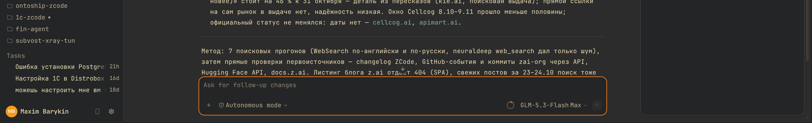
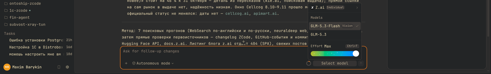
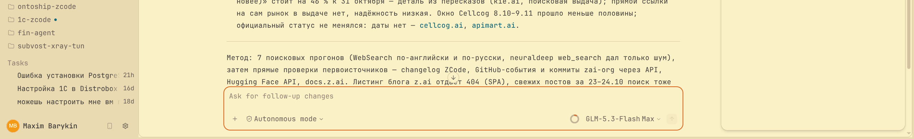
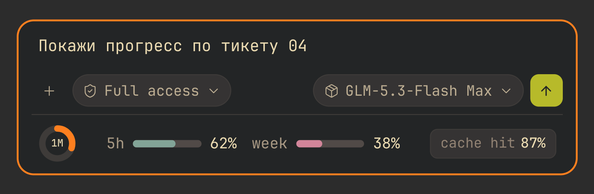
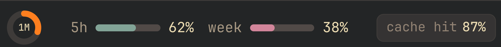

# План 5. Композер

Шаг 5 — композер. Только палитра: силуэт, ширина и центровка остаются
стоковыми (прежние A1/A2 откачены).

Разведка 3.16.2: инпут композера — `div[contenteditable]` без
`data-slot`, внутри `FORM` в `.chat-composer-region`
(`data-testid="v4-composer"`, `data-input-routing`), обёртка
`.chat-composer-input-surface`. Рамка и фон самого композера уже стоят
на паре `--color-input*`: обёртка несёт `rounded-2xl border
border-input-border bg-input` (см. дополнение ниже про
`data-composer-layout`). Гипотеза с `[data-slot="textarea"]` для этой
версии неверна.

Дополнение разведки (2026-10-22, статический проход по бандлу перед
шагом 5). Правка к прежней записи: `data-composer-layout` в 3.16.2
есть — атрибут на обёртке композера, значение кодирует состояние
раскладки. Семейство `data-composer-*` широкое: `-trailing-actions`/
`-leading-actions` (тулбар), `-action-menu`, `-compact`,
`-collapse-priority`, `-model-icon`, `-combined-model`,
`-trigger-frame` (open/closed), `-file-attachments-row`,
`-context-attachments-row`. Хуки по задачам: 5.4/5.5 —
`-model-list`/`-provider-list` (подтверждены живьём ранее),
статус-точка провайдера `data-provider-status` = `ready | unavailable
| disabled`, красится утилитами `text-success`/`text-warning` — уже
на токенах темы; подменю провайдера монтируется в отдельный портал
Radix (`[data-radix-popper-content-wrapper]`, живёт только открытым,
в поток не переносится — «провайдеры списком» CSS-ом не делаются,
фидбек апстриму подан). 5.6 — `data-composer-thought-control`
(+`-thought-label`, `-stop`). 5.8 — напоминание о сбросе квоты:
`data-context-reset-reminder` (+`-copy`, `-dismiss`); шкала расхода —
предположительно общий прогресс из 4.3 с сегментами (гард
`:not([class~="bg-transparent"])`), какие слоты монтируются в
карточке — проверить живьём. 5.9 — `data-usage-used`/`data-usage-max`
подтверждены, компонентных имён в бандле нет (как у метрик 4.4).
5.10 — прямые хуки `data-composer-attachment-kind`/`-remove`, классы
`Attachment*` не нашлись. 5.12 — `data-queue-item-id`,
`data-queue-count`, `data-queue-auto-drain`. 5.13 — `prompt-mention`
подтверждён. 5.14 — своих хуков у слэш-панели нет, только `command-*`
слоты (теперь факт). 5.16 — классы `suggested-prompt*` существуют.
5.17 — dedicated хуков нет (welcome — только i18n-ключи).
**5.18 — голосового ввода в сборке нет вовсе**: компонентных имён
(`SpeechInput`/`MicSelector`/`Transcription`) = 0, i18n-ключей
(`chat.voice*`, `voice-input`) = 0, `SpeechRecognition` = 0; хиты
`getUserMedia`/`MediaRecorder` — из miniaudio и записи экрана
computer-use, строка `voice:` — из встроенных схем-примеров. Задача
5.18 закрывается как «поверхности нет», правило не заводится; для 5.3
своего хука кнопки не нашлось — кандидаты на живую проверку:
контейнер `-trailing-actions` и класс `bg-brand`, как у Submit
карточки вопроса.

Статус 2026-10-24, финальный: **шаг 5 закрыт** — 18 задач (5.1–5.18,
из них 5.9 и 5.18 записями-ограничениями). Тема покрывает 68 из 90
задач (шаги 1–5). Коммиты: `d5f159f` — палитра шага одной секцией;
`c3e495b`…`3a4f544` — доводка по отзывам пользователя тем же днём.

**В теме (итоговые состояния, приёмка в обеих схемах на 3.16.2 под
лоадером; светлая — атомарной подменой классов с откатом и паузой
~350 мс: стоковый `transition-colors` отдаёт промежуточное
анимированное значение; скриншоты ниже):**

- 5.1 тулбар приглушён (`#bdae93` на плашке, 7,53:1; светлая 5,74:1);
  семафор квоты и кнопки `v4-*` исключены (ловушка (0,2,1) от `:not`);
- 5.2 каретка брендом; плейсхолдер уже на целевом `#928374` (стоковый
  класс), правило не потребовалось;
- 5.3 отправка `v4-composer-send` (+`-clear-queue-send`/
  `-keep-queue-send`) — зелёная пара подтверждения ask-карточки
  (иконка-инверс 7,94:1; светлая 5,02:1), disabled на surface —
  подтверждено живьём на пустом вводе, hover — `CSS.forcePseudoState`
  (`#d0d426`);
- 5.3 стоп `v4-stop` — контур: рамка 2px `--color-destructive`
  (толщина по явному выбору пользователя), прозрачная середина, глиф
  `--zskin-text-destructive`; hover заливает destructive-surface внутрь.
  Три отвергнутые итерации: сплошная заливка («ты испортил кнопку» —
  конфликт с бренд-рамкой), голый глиф (потерялся), тинт-плашка 16%
  («рамка слишком неконтрастная»);
- 5.4/5.5/5.6/5.7 меню модели/провайдера/режима/мышления — выбранная
  строка на `--color-selected` (8,45:1; светлая 6,76:1) с menu-hover при
  подсветке; чипы capability и label аккаунта на muted-паре (4,72:1);
  триггер уровня мышления брендом (светлая `#af3a03`, 5,40:1);
- 5.8 кольцо контекста: 22px, штрих 5.5 (~5px, принято пользователем),
  трек `#504945`, дуга брендовая; `overflow: visible` — viewBox 24 при
  r=10 не даёт утолщить штрих напрямую, а r менять нельзя (dasharray/
  offset закодированы на эту окружность); напоминание о сбросе квоты —
  warning-пара (9,67:1; светлая 4,88:1); шкала поповера — уже на
  usage-chart-токенах (снято живым открытием hover-card);
- 5.10/5.12/5.13/5.16 чипы вложений, очередь, упоминаний, подсказок —
  пары surface/selected из плана (правила-гипотезы до первого
  монтирования: хуки подтверждены бандлом);
- 5.13–5.15 cmdk `command-item[data-selected="true"]` на
  `--color-selected` — общий язык выбранной строки.

**Записи-ограничения (закрыты без правила):**

- Утверждённый мокап статус-линии (кольцо 36px с «1M», лимиты 5h/week,
  чип «cache hit») в 3.16.2 не собираем: лимитов, кеша и центральной
  цифры в DOM композера нет (числа — только сырой `aria-label`),
  процент CSS не считает. Апстрим-запрос.
- Показания used/max из скрытого спана `v4-model-config` были раскрыты
  attr()-триалом в живое чтение рядом с кольцом — работали и обновлялись
  на лету (Chromium 146), пользователь отверг: «просто в числах смысла
  нет» — спан остаётся скрытым.
- Сегментное кольцо отвергнуто ранее по живому тесту (субпиксельные
  зазоры на 22px, см. ниже).
- 5.9: правая панель usage не смонтирована на момент приёмки; палитра
  уже на токенах, правило не требуется.
- 5.18: голосового ввода в сборке нет — поверхности нет, правило не
  заводится.

Разведка шага переписана фактом:

- Отправка — не безымянная кнопка: тестиды из таблицы констант бандла
  `v4-composer-send`, `v4-composer-clear-queue-send`,
  `v4-composer-keep-queue-send`; стоп — `v4-stop` (смонтирован во время
  задачи). Кандидаты «`-trailing-actions` + `bg-brand`» не понадобились.
- 5.6/5.7: «сегменты» плана не существуют — и режим, и глубина мышления
  рендерятся dropdown-радио-группами (`chat-mode-select-item-*`,
  `chat-thought-level-select-*`), триггеры `chat-mode-select-trigger` /
  `chat-thought-level-select-trigger`. Правило выбранной строки — общее
  для всех четырёх композерных меню.
- Thought-контроль в меню модели — слайдер «Effort Max Ctrl+T»
  (`composer-thought-slider`/`-track`/`-value`) со стоковым градиентом;
  вне скоупа плана, оставлен стоком.
- 5.16: классов `suggested-prompt*` нет — подсказки монтируются как
  `data-v4-draft-suggested-prompts` (два лейаута: list-строки на стоковом
  `hover:bg-hover` и чип-водопад `[data-v4-draft-suggested-prompts-group]`
  с `data-draft-suggested-prompt`).
- 5.2: плейсхолдер — стоковый `div.absolute.text-foreground-subtlest`
  рядом с `contenteditable` (виден при пустом вводе) — уже на целевом
  `#928374`; правило не потребовалось. Каретка — `caret-color: brand`.
- Ловушка очерёдности: тулбар-правило 5.1 имеет (0,2,1) из-за `:not` и
  перебивает цвет иконок у кнопок 5.3 — они исключены вторым
  `:not([data-testid^="v4-"])`.
- 5.4: label-секция меню («Models»/аккаунт) смонтировалась и покрасилась
  muted — гипотеза подтверждена живьём.

Правила-гипотезы (поверхности не монтируются без состояния, хуки
подтверждены бандлом): чипы вложений `data-composer-attachment-kind`
(фон surface, рамка border, имя subtle 6.03:1; светлая 5.18:1), крестик
`-remove` destructive по hover; очередь `data-queue-item-id` (surface,
hover selected); напоминание `data-context-reset-reminder` — warning-пара
(9.67:1 на карточке; светлая 4.88:1), степеней «критично» в бандле нет;
`.prompt-mention` (surface + popover-border + foreground, 9.57:1);
command- panels — общий `[data-slot="command-item"][data-selected="true"]`
на `--color-selected` (правило затрагивает и cmdk-палитру команд —
единый язык выбранной строки).

Закрыто токенами без новых правил: 5.8 шкала поповера контекста —
сегментированный progress с инлайн-заливками `--color-usage-chart-*`
(снято живым открытием hover-card через CDP), строки источников на
subtle; 5.9 цифры/подписи на foreground/subtlest, полосы на
usage-chart-рампе; 5.11 диалог превью — пары 1.7 (своя подложка
изображения без хука не заводится); 5.17 приветствие — базовые токены
(bg/foreground/subtlest, dedicated хуков нет — факт разведки).

Записи-ограничения (закрыты без правила, как 4.4):

- **5.9.** Правая панель usage в момент приёмки не смонтирована (в
  сессии нет todo/цели/фоновых задач); единственный носитель
  `data-usage-used`/`-max` в DOM — скрытый спан `v4-model-config`
  внутри композера (`class="hidden"`, живьём). Когда панель смонтируется,
  палитра уже стоит на токенах — правило не требуется; числа
  «количество/лимит» и процент в композере по-прежнему только в сыром
  `aria-label` — апстрим-запрос статус-линии в силе.
- **5.18.** Голосового ввода в сборке 3.16.2 нет (разведка 2026-10-22:
  компонентных имён и i18n-ключей ноль). Поверхности нет — правило не
  заводится; возвращается в работу при появлении микрофона в композере.

Ссылки: [общее](00-common.md) · [образец стиля](../oh-my-pi-output-style.md) · [join-таблица](../components-join.md).

Статус 2026-10-22 (начало шага 5): согласован дизайн композера —
рамка «активной карточки» 2px бренда и видимое кольцо контекста. Внесено
в тему (секция в конце файла): `[data-composer-layout]` — рамка 2px,
hover переприбит (стоковый `hover:border-input-border-hover` бьёт плоский
атрибутный селектор); `[data-testid="chat-context-usage-trigger"]` —
кольцо 22px, трек `#504945`, дуга брендовая, процент живёт в инлайн
`stroke-dashoffset`.

Согласованный макет статус-линии (мокапы сессии, итог
`composer-ring-center.html`): раскладка «Подвал поля» — строка статуса
внутри рамки под тулбаром; кольцо 36px (дуга — использование, в центре
размер окна «1M»), лимиты 5h/week — полосы 64×7 с кремовыми значениями
и muted-подписями, кеш — чип «cache hit» со значением кремовым. В тему
не перенесено: в DOM композера нет ни лимитов, ни кеша (они в правой
панели usage: `data-usage-used`/`-max`), ни текста размера окна (числа
контекста — только сырой `aria-label="Context usage 98,774 of
1,000,000"`). Это запрос апстриму на метрики в композере; в теме ничего
не подделывается. Живая приёмка рамки и кольца — зондом в обеих
схемах, hover проверен `CSS.forcePseudoState`.

**Финальный прототип — `docs/mockups/composer-statusline-v1.html`:**
кольцо НЕПРЕРЫВНОЕ (дуга = использование, в центре размер окна кремовым
`1M` 9,5px/500). Спека: подвал поля внутри рамки под тулбаром; кольцо
36px, штрих 6px, трек `#504945`; лимиты 5h/week — полосы 64×7 радиус 4,
значения кремовые, подписи muted `#a89984`; цвета метрик разные: кольцо
`#fe8019`, 5h `#83a598`, week `#d3869b`; кеш — чип «cache hit» на
`#32302f` с кремовым значением. Смысл различают подписи, а не цвета.
Рамка композера — 2px бренда (язык активной карточки), отправка —
зелёная с тёмной стрелкой, стоп — красный.

Скриншоты концепта (сняты в живом клиенте на иконках приложения):

**Что уже в теме (`32c23c5`):** рамка `[data-composer-layout]` 2px бренда
(hover переприбит) и кольцо `chat-context-usage-trigger` 22px с треком
`#504945` и брендовой дугой.

**Что ждёт апстрима (в тему не переносится):** подвал статуса целиком —
лимиты 5h/week и кеш в композере не смонтированы (они в правой панели
usage: `data-usage-used`/`-max`), центральная надпись размера окна (числа
контекста — только сырой `aria-label="Context usage 98,774 of 1,000,000"`),
форматирование «300K / 1M» и процента (CSS не считает арифметику над
`attr()`). Подвал реализуем в правой панели уже сейчас — данные там есть.

**Отвергнутые итерации (2026-10-22/23):** палитро-варианты композера без
статуса («всё не то»); кольцо 20px у отправки и 24px у модели («нет»);
текст `300K / 1M` вместо кольца (оба оформления); сегментное кольцо
(см. ниже). Причина сегментов — размер, не возможность.

Сегментный вариант (`composer-statusline-v2.html`, 10 сегментов по 10%)
отвергнут пользователем 2026-10-22 по живому тесту. Проверка уточнила
прежнее утверждение: сегментация в CSS **достижима** — маска
`repeating-conic-gradient` режет дугу на 10 секторов без данных (доля
остаётся в инлайновом `stroke-dashoffset`); чисто выходит на 84px с
`opacity:1` и `stroke-linecap: butt`. Но в реальном размере кольца 22px
зазоры субпиксельные (0,6–1px), и края сегментов рвутся о маску — вид
читается как грязь. Поэтому зафиксировано непрерывное кольцо; сегменты
имеют смысл только если кольцо когда-нибудь станет 36px+ в подвале с данными
(апстрим).

### 5.1. Композер целиком (пара 19)
`ConversationComposer`, `V4ComposerToolbar`.
**Что.** Поле на `#1d2021`, рамка `#504945`, фокус brand; тулбар — текст
`#bdae93`; геометрию и раскладку не менять.
**Как.** `--color-input*` (есть); `.chat-composer-region`
(`data-testid="v4-composer"`) — только цвета, без width/padding.

### 5.2. Текстовый редактор (пара 21)
`LexicalChatInput`, `ChatPromptEditor`.
**Что.** Текст `#ebdbb2`, плейсхолдер `#928374`, каретка brand, выделение —
`#504945`.
**Как.** Инпут — `div[contenteditable]` внутри
`.chat-composer-input-surface` (3.16.2), `caret-color:
var(--color-brand)`; `::selection` уже есть.

### 5.3. Отправка и стоп (пара 22)
`PromptInputSubmit`, `PromptInputButton`.
**Что.** Отправка: фон brand, иконка `#1d2021`; disabled — фон `#32302f`,
иконка `#7c6f64`; стоп — destructive.
**Как.** Своего хука у кнопки в бандле нет; кандидаты на живую
проверку: контейнер `data-composer-trailing-actions` и класс `bg-brand`
(как у Submit карточки вопроса); `--color-foreground-inverse`.

### 5.4. Выбор модели (пара 23)
`ComposerModelMenu`, `V4ComposerModelControls`.
**Что.** Меню на `#1d2021`; выбранная модель — `#3c3836`, ховер —
`#32302f`; метаданные — `#928374`; компакт-иконка модели — как есть.
**Как.** `[data-slot="dropdown-menu-content"]:has([data-composer-model-list])`
(подтверждено живьём), `dropdown-menu-item`, `data-composer-model-icon`,
`data-composer-trigger-frame`.

### 5.5. Провайдер и аккаунт (пара 24)
`ComposerProviderMenu`.
**Что.** Как 5.4 + статус-точка провайдера (success/warning/error) и
dim-подпись аккаунта.
**Как.** `data-provider-status` = `ready | unavailable | disabled`
(подтверждён, красится `text-success`/`text-warning` — уже на токенах);
список провайдеров — в отдельном портале Radix, в поток панели не
переносится (решение «без hover-подменю» в силе, фидбек апстриму
zai-org/feedback подан ранее).

### 5.6. Глубина мышления (пара 25)
`ThoughtLevelCycleControl`, `ComposerEffortHeading`.
**Что.** Уровень — brand, подпись — `#928374`; активный сегмент —
`#3c3836`.
**Как.** `[data-composer-thought-control]` (подтверждён; ещё `-thought-label`,
`-stop`), `[data-slot="tabs-trigger"]`.

### 5.7. Режим работы (пара 26)
`ChatModeSwitchControl`, `V4ComposerModeSwitch`.
**Что.** Сегмент: активный — фон `#3c3836`, текст `#ebdbb2`; неактивный —
`#bdae93`.
**Как.** `[data-slot="tabs-trigger"]`, `--color-selected`.

### 5.8. Расход контекста (пара 27)
`ChatContextUsage`, `ContextQuotaResetOpportunityReminderContent`.
**Что.** Шкала — ramp `context-breakdown`; предупреждение — `#fabd2f`,
критично — `#fb4934`; не скрывать.
**Как.** `--color-context-breakdown-*` (есть); напоминание о сбросе —
`data-context-reset-reminder` (+`-copy`, `-dismiss`); шкала — вероятно,
прогресс из 4.3 с сегментами, слоты в карточке проверить живьём.

### 5.9. Расход и стоимость (пара 28)
`ChatCodingPlanMcpUsageMeter`, `CodingPlanUsageRemainingPanel`.
**Что.** Полосы — `usage-chart` ramp, лимит — warning/destructive; цифры —
`#ebdbb2`, подписи `#928374`.
**Как.** `--color-usage-chart-*` (есть), `data-usage-used`/`data-usage-max`
(подтверждены; компонентных имён в бандле нет).

### 5.10. Чипы вложений (пара 29)
`Attachments`, `Attachment`, `AttachmentRemove`.
**Что.** Чип: фон `#32302f`, рамка `#3c3836`, имя `#bdae93`, крестик —
hover destructive.
**Как.** `data-composer-attachment-kind`/`-remove` (подтверждены;
классы `Attachment*` в бандле не нашлись), токены surface/border.

### 5.11. Просмотр вложения (пара 30)
`ImagePreviewDialog`, `ImageThumbnailGallery`.
**Что.** Диалог на `#1d2021`, рамка `#504945`, подложка изображения — `#282828`.
**Как.** 1.7 + `[data-slot="dialog-content"]`.

### 5.12. Очередь сообщений (пара 31)
`ConversationQueuePanel`, `Queue`.
**Что.** Элемент — `#32302f`, номер — brand, активный — `#3c3836`,
hover — `#3c3836`.
**Как.** `data-queue-item-id`/`-count`/`-auto-drain` (подтверждены),
токены surface/selected.

### 5.13. Упоминания и автодополнение (пара 32)
`MentionPanel`, `.prompt-mention`.
**Что.** Панель — popover; выбранный пункт — `#3c3836`; чип упоминания —
`#32302f` с рамкой `#504945`, текст `#ebdbb2`.
**Как.** `.prompt-mention` (подтверждён, 6 вхождений),
`[data-slot="command-item"]`.

### 5.14. Slash-команды (пара 33)
`SlashCommandPlugin`, панель секций.
**Что.** Как 5.13; команда — mono `#ebdbb2`, описание — `#928374`.
**Как.** Своих хуков у панели нет — только `command-*` слоты (факт
разведки); `[data-slot="command-item"]`.

### 5.15. История промптов (пара 34)
`HistorySearchComponent`, `CommandCenterSearchHistory`.
**Что.** Оверлей на popover; совпадение — `--color-find-highlight`.
**Как.** `[data-slot="command-input"]`/`command-item`, find-токены.

### 5.16. Подсказки в пустом поле (пара 35)
`ConversationDraftSuggestedPrompts`, `ComposerHint`.
**Что.** Чипы подсказок: `#32302f`, рамка `#3c3836`, hover `#3c3836`,
текст `#bdae93`→`#ebdbb2` в hover.
**Как.** Классы `suggested-prompt*` (подтверждены), токены
surface/selected.

### 5.17. Приветствие (пара 36)
`WelcomeScreen`, `WelcomeComponent`.
**Что.** Фон базы, заголовок `#ebdbb2`, подсказка `#928374`, акцент — brand.
**Как.** Dedicated хуков нет (welcome — только i18n-ключи); токены
(без геометрии).

### 5.18. Голосовой ввод (пара 37)
`SpeechInput`, `MicSelector`, `Transcription`.
**Поверхности нет (разведка 2026-10-22).** В сборке 3.16.2 голосового
ввода нет: компонентных имён и i18n-ключей ноль, `SpeechRecognition`
не встречается; хиты `getUserMedia`/`MediaRecorder` — чужие (miniaudio,
запись экрана computer-use). Задача закроется как 4.4 — записью об
ограничении, без правила; если в будущей версии композер получит
микрофон, задача возвращается в работу с живой разведкой.

## Внеплановое (выполнено 2026-10-21): ширина поповеров

Не входило в 90 задач плана — пожелание по ходу волны 2. Коммит `15a9b58`.

**Что.** Карточка контекста (5.8) и меню модели (5.4, 5.5) больше не обрезают
содержимое: ширина идёт за содержимым, а не по зашитому значению. Было 320 px
у карточки (заголовок «Context windows … 353.1K/1M (33.7%)» уходил в
многоточие, подписи источников тоже) и 288 px у меню («Alibaba Cloud
(Global) API» и «deepseek-v4.1-flash-1017 Vision» рвались посередине).
Стало 344 и 357 px соответственно, обрезки нет.

**Как.** `width: max-content` с потолком `min(100vw − 24px, 44rem)` и снятый
`max-width` у потомков с `truncate`.

**Хуки (проверено вживую).** Карточка контекста:
`[data-slot="hover-card-content"][class~="!w-80"]`. В бандле она собрана общим
компонентом контента, но в DOM монтируется как `hover-card-content`, а не
`popover-content` — на этом первая попытка промахнулась. Меню модели:
`[data-slot="dropdown-menu-content"]:has([data-composer-model-list])` и то же
с `[data-composer-provider-list]`.

**Ловушка, которую стоит помнить всем следующим задачам.** Tailwind v4 держит
утилиты в `@layer utilities`, а для `!important` порядок слоёв обратный:
правило вне слоя проигрывает слойному, даже с более высокой специфичностью.
Стоковая ширина задана как `!w-80`/`!w-64` с `!important`, поэтому правка,
положенная вне слоя, молча не срабатывала (замер показывал те же 320 px).
Решение — наше правило тоже внутри `@layer utilities`, где решает
специфичность.

**Проверка.** Тёмная схема, живой клиент: у всех потомков карточки и меню
`scrollWidth == clientWidth`; искусственная строка в 600 символов упирается в
потолок 44rem, а не уводит поповер за экран. Схема на правило не влияет —
меняется только ширина.
